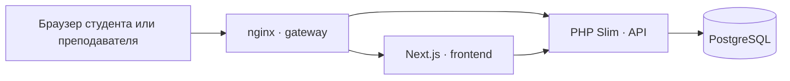

# Архитектура и границы симуляции

Web Security Lab — браузерный учебный интерфейс, API сценариев и хранилище прогресса, запускаемые как Docker Compose приложение.

## Компоненты

- **nginx** публикует один HTTP-порт и направляет запросы к интерфейсу и API.
- **Next.js** содержит студенческий интерфейс, учебный магазин, перехватчик, справочник и панель преподавателя.
- **PHP API** хранит сессии и прогресс и выполняет детерминированные учебные сценарии.
- **PostgreSQL** хранит студентов, события, результаты и состояние занятий.
- Сеть базы изолирована внутренней Docker-сетью.

## Структура репозитория

| Путь | Ответственность |
|---|---|
| `frontend/src/app/` | Маршруты приложения и метаданные страниц |
| `frontend/src/components/` | Интерфейсы студента, преподавателя и магазина |
| `frontend/src/lib/` | Клиент API и сюжетная навигация |
| `api/src/Domain/Lab/` | Каталог заданий, этапы и правила зачёта |
| `api/src/Domain/Shop/` | Модель учебного магазина |
| `api/src/Application/` | Сценарии взаимодействия и сервисы |
| `api/src/Infrastructure/` | HTTP-ответы и работа с PostgreSQL |
| `api/migrations/` | Начальная схема хранилища |
| `docker/` | Dockerfile и конфигурация nginx |
| `docs/` | Руководства, архитектура и ключ преподавателя |
| `lab` | Команды запуска, остановки и сброса стенда |

## Поток учебного запроса

1. Студент выполняет действие в интерфейсе магазина.
2. Интерфейс сохраняет запрос в журнале и связывает его с активной сессией.
3. Перехватчик позволяет загрузить запрос, изменить метод, путь, заголовки или JSON-тело.
4. API направляет виртуальный запрос в движок задания.
5. Движок возвращает смоделированный HTTP-ответ и, если условие распознано, результат задания.
6. Прогресс и событие сохраняются; панель преподавателя получает агрегированное состояние.

## Модель учебной безопасности

Это симулятор, а не намеренно уязвимый сервер, предоставляющий shell или произвольные инструменты атаки.

- Маршруты для расследования обрабатываются движком через `/api/workbench/send`.
- SQL-инъекция распознаётся учебным сценарием; произвольный SQL не выполняется.
- SSRF возвращает смоделированные ресурсы; обращения к произвольным внешним или внутренним адресам не выполняются.
- Сценарий гонки моделирует порядок чтения и записи; параллельные запросы не создают настоящую гонку процессов.
- XSS использует изолированный учебный предпросмотр и ограниченные шаблоны; автоматический зачёт не является доказательством выполнения любого JavaScript.
- Отзывы и история изолированы по студентам.
- Данные пользователей, покупки, токены и адреса сценариев вымышленные.

Запускайте приложение в доверенной учебной сети. Не публикуйте порт стенда в интернете и не добавляйте реальные секреты или персональные данные.

## Данные и сброс

История и прогресс сохраняются в PostgreSQL Docker-volume. `./lab stop` останавливает контейнеры без удаления тома. `./lab reset` выполняет `docker compose down -v`, поэтому удаляет базу и все результаты занятия.

Сессионная cookie действует 8 часов. Новая регистрация создаёт новую запись, даже если имя совпадает с предыдущим.

## Изменение сценариев

Каталог заданий, требования к шагам и условия автоматического зачёта связаны. При изменении сценария сверяйте:

- идентификатор и описание в каталоге;
- виртуальные ответы и условия зачёта в движке;
- подсказки и этапы, которые видит студент;
- материалы панели и преподавательский ключ.

Рабочий процесс разработки и команды проверок описаны в [CONTRIBUTING.md](../CONTRIBUTING.md).
